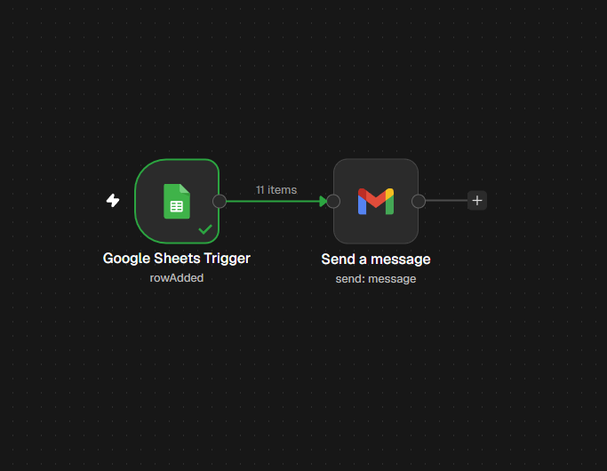
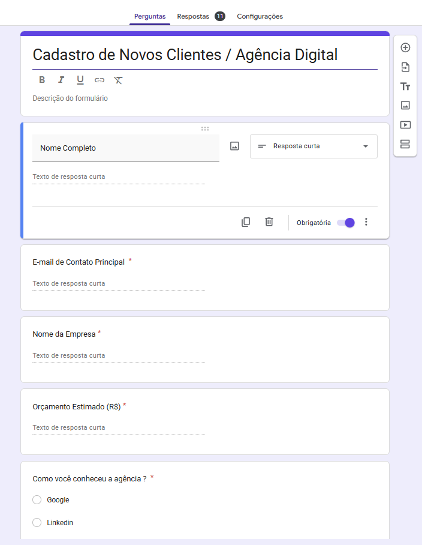
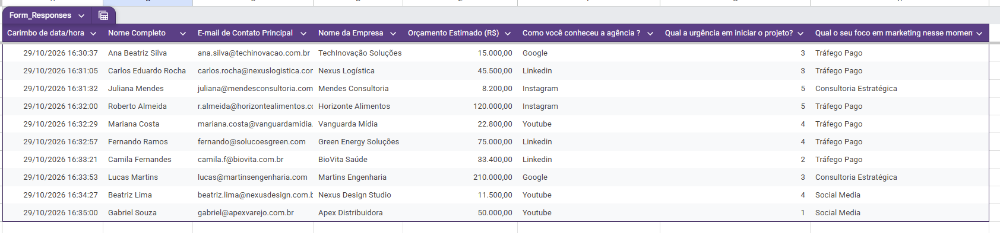
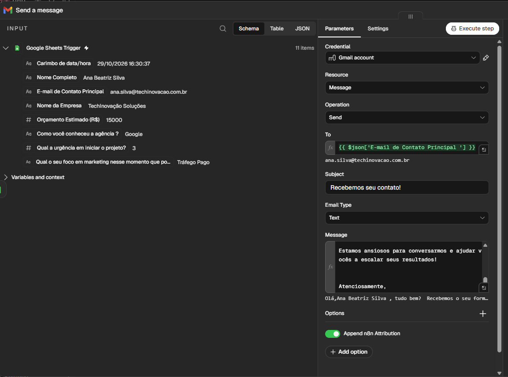
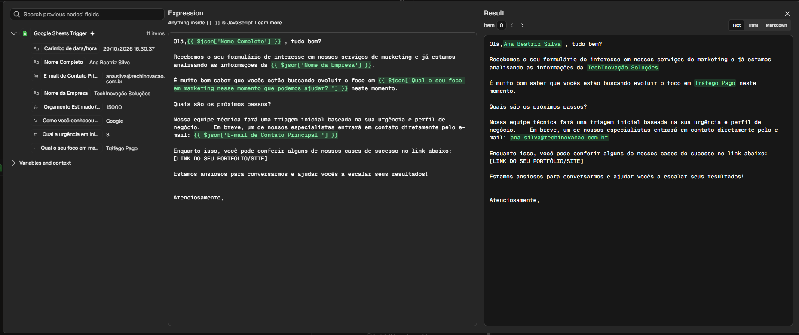
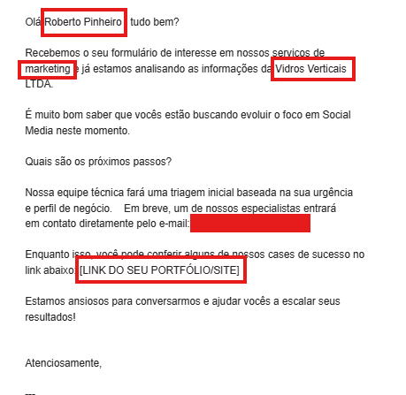

# Automação de Envio de E-mails Personalizados com n8n

Projeto de automação utilizando **n8n** para captura automatizada de dados em tempo real a partir de respostas de formulários (Google Sheets) e envio imediato de e-mails de confirmação e boas-vindas totalmente personalizados via Gmail.

> ⚠️ **AVISO IMPORTANTE:** Todos os dados, nomes, empresas e e-mails exibidos nos exemplos e imagens deste repositório são **completamente fictícios** e foram utilizados exclusivamente para fins de demonstração e teste de funcionalidade.

---

## 📌 Visão Geral do Fluxo

O fluxo de automação é simples, direto e altamente eficiente:

1. **Gatilho (Google Sheets Trigger):** O n8n monitora continuamente a adição de novas linhas na planilha conectada.
2. **Envio Dinâmico (Gmail):** Ao detectar uma nova linha, o n8n mapeia as informações recebidas e dispara uma mensagem personalizada para o destinatário.

---

## 📸 Passo a Passo e Demonstração

### 1. Captura de Dados (Google Forms & Google Sheets)
O processo inicia quando um cliente em potencial preenche o formulário de cadastro.

As respostas são enviadas automaticamente para uma planilha do Google Sheets, onde cada coluna representa um campo específico do formulário:

---

### 2. Mapeamento de Variáveis no n8n
O n8n permite capturar o conteúdo de cada coluna da planilha e vinculá-lo como **variável dinâmica** no corpo do e-mail usando a sintaxe `{{ $json['NOME_DA_COLUNA'] }}`.

No painel do nó do **Gmail**, mapeamos o e-mail do destinatário no campo `To` e estruturamos a mensagem:

Ao abrir o editor de expressões no n8n, é possível visualizar em tempo real a substituição dos campos da planilha pelas variáveis correspondentes na mensagem:

---

### 3. Resultado Final (E-mail Enviado)
O e-mail final é montado e entregue de forma automática ao cliente com todos os campos personalizados preenchidos corretamente de acordo com as respostas enviadas:

---

## 🛠️ Tecnologias Utilizadas

- **[n8n](https://n8n.io/):** Plataforma de automação de fluxos de trabalho.
- **Google Sheets:** Armazenamento e captura das respostas do formulário.
- **Gmail:** Disparo automatizado dos e-mails.

---

## 🚀 Como Importar e Executar este Workflow

1. **Fazer o Download:**
   - Faça o download do arquivo JSON do fluxo presente neste repositório: [`n8n_enviodeEmail02.json`](./n8n_enviodeEmail02.json).

2. **Importar no n8n:**
   - Abra a sua instância do n8n.
   - Vá no menu **Workflows** > **Import from File...** e selecione o arquivo `.json`.

3. **Autenticar Credenciais:**
   - Configure sua conta do **Google Sheets** no nó de gatilho.
   - Configure sua conta do **Gmail** no nó de envio.

4. **Vincular sua Planilha:**
   - Altere o ID/URL do nó do Google Sheets para apontar para a sua planilha.
   - Verifique se o nome das colunas da sua planilha corresponde às variáveis mapeadas na mensagem `{{ $json['Sua Coluna'] }}`.
   - Ative o fluxo!
